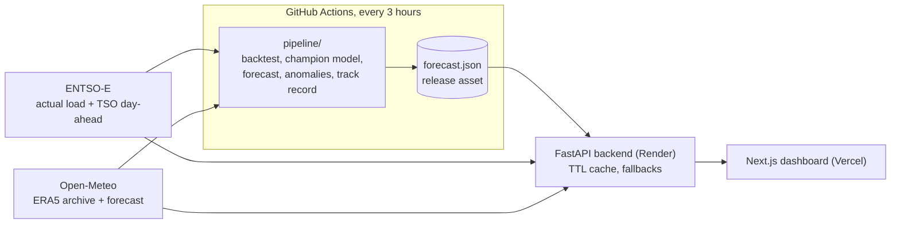

# ⚡ GridSense

[](https://github.com/kamal-lochan-sahu/gridsense/actions/workflows/ci.yml)
[](https://github.com/kamal-lochan-sahu/gridsense/actions/workflows/forecast.yml)
[](LICENSE)

**Real-time electricity load dashboard for European grids, with a 24-hour forecast that is openly benchmarked against the grid operators' own forecasts.**

- Live app: <https://gridsense-eight.vercel.app>
- API: <https://gridsense-backend-k8pa.onrender.com> ([interactive docs](https://gridsense-backend-k8pa.onrender.com/docs))

> The API runs on a free Render instance. After a period of inactivity the first request can take up to a minute while the server wakes up.

## What it does

GridSense pulls official actual-load data from the [ENTSO-E Transparency Platform](https://transparency.entsoe.eu/) for **Germany, France, Spain and Poland** and shows it next to local weather, a forecast, an anomaly check and a track record.

- **Load chart per country**: the last 24 hours in 15-minute steps with real timestamps in your local time, plus max / average / min.
- **24-hour forecast with an 80% interval** for every country. A scheduled pipeline re-selects the best of 16 candidate models for each country every 3 hours; the dashboard names the model in use and how accurate it was in testing.
- **Track record**: how GridSense's day-ahead forecasts compared with the grid operator's (TSO's) own published forecast and with a naive baseline over the last 14 days, on the same hours. Most dashboards only show a forecast; this one shows whether it was any good.
- **Anomaly detection**: compares each recent hour with what the model predicted for it and flags spikes and dips that are unusual for that country. A slow drift of the whole load is reported as a level, not as a pile of anomalies.
- **Weather**: current temperature, wind speed and cloud cover for Berlin, Paris, Madrid and Warsaw (Open-Meteo).
- **Resilient by design**: results are cached, data providers are called in parallel with timeouts and retries, and if a provider or the pipeline output is unavailable the API serves the last good data (flagged `"stale": true`), a documented fallback, or a clear `502` instead of made-up values.
- Auto-refresh every 5 minutes, responsive layout.

ENTSO-E publishes load data with a delay of roughly one hour, so the newest point is never "now". Each card shows the time of its latest value.

## How good is the forecast?

Honestly: better than a simple baseline everywhere, better than the grid operator in Germany, and clearly behind the operators in France, Spain and Poland. Snapshot, average error over the 7 days to 21 October 2026 (lower is better):

| Country | GridSense | TSO day-ahead | Same hour last week |
| ------- | --------- | ------------- | ------------------- |
| Germany | **2.16 %** | 2.54 % | 2.96 % |
| France  | 3.50 %    | **1.19 %** | 4.29 % |
| Spain   | 2.63 %    | **0.90 %** | 5.59 % |
| Poland  | 2.35 %    | **1.74 %** | 4.69 % |

The dashboard always shows the current numbers. Read them with these caveats (details in [docs/FORECASTING.md](docs/FORECASTING.md)):

- The comparison is a *walk-forward* test: for every past day, today's chosen model forecasts the 24 hours using only data up to 10:00 UTC the day before, roughly when TSOs publish. TSOs publish at different times, so the information is similar but not identical.
- The model was chosen on recent days that overlap the test window, which flatters GridSense a little.
- In tests the temperature "forecast" is the measured temperature. A real forecast is 1-2 °C off, so temperature-based models look slightly better than they will be live.
- Two weeks is a short sample from one season (autumn), and TSOs use far richer weather data than GridSense does.

## Architecture



Training never runs on the API server: the free Render instance only serves data. The pipeline publishes one `forecast.json` as an asset of the `forecast-data` GitHub release (deliberately not a git branch: Vercel builds every pushed branch).

## How the forecast works

1. Every 3 hours the pipeline downloads about 90 days of hourly load per country and the matching temperature series.
2. It backtests 16 candidate models (seasonal-naive and holiday-aware averages, level- and error-corrected variants, Prophet, a calendar + temperature regression and ensembles) on the last 10 days.
3. It picks the **simplest model within 3 % of the best error**, forecasts the next 24 hours, derives an 80 % interval from the backtest errors, checks the last 24 hours for anomalies and builds the track record.
4. The result is published as `forecast.json`; the backend caches it and serves it through `/forecast/{country}`, `/anomaly/{country}` and `/trackrecord/{country}`.

Naive models and Prophet work on local wall-clock time (clock changes do not break them) and treat public holidays like Sundays. See [docs/FORECASTING.md](docs/FORECASTING.md) for every model, the selection rule, the anomaly method and what did not work.

## Tech stack

| Layer    | Technology                                                               |
| -------- | ------------------------------------------------------------------------ |
| Frontend | Next.js 16, React 19, Tailwind CSS 4, Recharts                           |
| Backend  | Python 3.12, FastAPI, requests, NumPy                                    |
| Forecast | Python 3.12, pandas, NumPy, statsmodels, Prophet (runs in GitHub Actions) |
| Data     | ENTSO-E Transparency Platform, Open-Meteo (forecast + ERA5 archive)      |
| Hosting  | Vercel (frontend), Render (backend), GitHub release asset (forecast data) |
| CI       | GitHub Actions (tests, scheduled forecast)                               |

## API

| Endpoint                     | Description                                                                 |
| ---------------------------- | --------------------------------------------------------------------------- |
| `GET /energy`                | 24h load of all countries (countries that fail are skipped)                 |
| `GET /energy/{country}`      | 24h load of one country: `germany`, `france`, `spain`, `poland`             |
| `GET /forecast/{country}`    | 24h forecast with 80 % interval, model name and its backtest error          |
| `GET /forecast`              | Same for Germany (kept for older clients)                                   |
| `GET /anomaly/{country}`     | Anomalies in the last 24 hours (forecast-residual method, live z-score fallback) |
| `GET /trackrecord/{country}` | GridSense vs TSO day-ahead vs naive over 14 days: summary, daily errors, last 3 days hourly |
| `GET /weather`               | Hourly weather for all cities                                               |
| `GET /weather/{city}`        | Hourly weather for one city: `berlin`, `paris`, `madrid`, `warsaw`          |
| `GET /health`                | Liveness, configuration check and cache ages                                |

```bash
curl -s https://gridsense-backend-k8pa.onrender.com/forecast/germany | python3 -m json.tool | head -30
```

Energy responses include a timestamped `series` (`{time, load_mw}`, `null` marks a real gap), the resolution, summary statistics, `fetched_at` and `stale`. Forecast timestamps (`ds`) are UTC. Unknown regions return `404`; an unavailable data provider returns `502` with a `detail` message.

## Project structure

```
gridsense/
├── backend/
│   ├── main.py            # FastAPI app and routes
│   ├── core/              # config, TTL cache, cached data service
│   ├── data/              # ENTSO-E / Open-Meteo / forecast-file clients, ENTSO-E XML parser
│   ├── ml/                # live z-score anomaly fallback, bundled static Germany forecast (last-resort fallback)
│   └── tests/             # pytest suite (no network access needed)
├── pipeline/              # the forecasting pipeline (runs in GitHub Actions)
│   ├── run.py             # production run: champion model, forecast, anomalies, track record -> forecast.json
│   ├── models.py          # all candidate models
│   ├── champion.py        # rolling backtest and model selection
│   ├── trackrecord.py     # walk-forward comparison with the TSO
│   ├── anomaly.py         # forecast-residual anomaly detection
│   ├── history.py, weather.py, daytype.py   # data loading, temperature, holidays
│   ├── compare.py, backtest.py, diagnose.py # research tools
│   └── tests/
├── frontend/
│   ├── app/               # Next.js app router: dashboard page and layout
│   ├── lib/               # API client, types, formatting helpers
│   └── public/            # icons and manifest
├── docs/                  # FORECASTING.md (method and findings), PROJECT_MEMORY.md (project log)
├── render.yaml            # Render service definition
└── .github/workflows/     # ci.yml (tests), forecast.yml (scheduled pipeline)
```

## Run it locally

You need Python 3.12, Node.js 20+ and a free [ENTSO-E API token](https://transparency.entsoe.eu/) (register an account, email the platform support to enable RESTful API access, then copy the token from your account settings).

**Backend**

```bash
cd backend
python3 -m venv venv
source venv/bin/activate          # Windows: venv\Scripts\activate
pip install -r requirements.txt
echo "ENTSOE_API_KEY=your_token_here" > .env
uvicorn main:app --reload
```

The API is now on <http://localhost:8000> (docs at `/docs`). It reads the forecast from the public `forecast-data` release by default (see `FORECAST_URL`), so the forecast endpoints work without running the pipeline.

**Frontend**

```bash
cd frontend
npm ci
echo "NEXT_PUBLIC_API_URL=http://localhost:8000" > .env.local
npm run dev
```

Open <http://localhost:3000>. Without `NEXT_PUBLIC_API_URL` the frontend uses the production API.

**Forecast pipeline** (optional)

```bash
python3 -m venv .venv-pipeline
source .venv-pipeline/bin/activate
pip install -r pipeline/requirements.txt
python -m pipeline.run --synthetic --origins 4      # offline smoke run, no API key needed
python -m pipeline.run                              # real run (reads ENTSOE_API_KEY from backend/.env), writes pipeline/out/forecast.json
python -m pipeline.compare --countries spain        # every candidate model against the TSO, day-ahead
```

To use your own output, host `forecast.json` anywhere reachable over HTTP and set `FORECAST_URL` to its address.

## Configuration

| Variable                     | Where    | Default        | Purpose                                                  |
| ---------------------------- | -------- | -------------- | -------------------------------------------------------- |
| `ENTSOE_API_KEY`             | backend, pipeline | (required) | ENTSO-E web API security token                       |
| `ENERGY_TTL_SECONDS`         | backend  | `300`          | How long load data is cached                             |
| `WEATHER_TTL_SECONDS`        | backend  | `1800`         | How long weather data is cached                          |
| `MAX_STALE_SECONDS`          | backend  | `21600`        | Oldest cached load/weather served when a provider fails  |
| `FORECAST_URL`               | backend  | `forecast-data` release asset | Where the pipeline output is downloaded     |
| `FORECAST_FALLBACK_URL`      | backend  | (legacy URL)   | Tried only if `FORECAST_URL` fails; empty disables it    |
| `FORECAST_TTL_SECONDS`       | backend  | `600`          | How long the forecast file is cached                     |
| `FORECAST_MAX_STALE_SECONDS` | backend  | `172800`       | Oldest forecast file served when the download fails      |
| `PIPELINE_MAX_AGE_HOURS`     | backend  | `12`           | Older pipeline anomalies are replaced by the live z-score |
| `CORS_ORIGINS`               | backend  | `*`            | Comma-separated list of allowed origins                  |
| `LOG_LEVEL`                  | backend  | `INFO`         | Python logging level                                     |
| `NEXT_PUBLIC_API_URL`        | frontend | production API | Base URL of the backend                                  |

## Tests

```bash
# backend
cd backend
pip install -r requirements-dev.txt
python -m pytest

# forecast pipeline (from the repository root)
pip install -r pipeline/requirements-dev.txt
python -m pytest pipeline

# frontend
cd frontend
npm run lint && npx tsc --noEmit && npm run build
```

None of the test suites need network access or an API key. CI runs all three on every push to `main` and on pull requests.

## Deployment

- **Backend**: Render web service from `render.yaml` (root directory `backend`, health check `/health`). Set `ENTSOE_API_KEY` in the service environment.
- **Frontend**: Vercel project with root directory `frontend`. Optionally set `NEXT_PUBLIC_API_URL`.
- **Forecast pipeline**: the `Forecast` workflow (`.github/workflows/forecast.yml`) runs every 3 hours, on pushes that change `pipeline/**`, and on demand. Add the repository secret `ENTSOE_API_KEY`; the workflow creates and updates the `forecast-data` release by itself. Scheduled and manual runs only work from the default branch.

## Limitations

- Four countries, hourly resolution, a 24-hour horizon.
- Public holidays are national ones; regional holidays and bridge days are not modelled (the worst single miss in testing, Spain on 9 October, fell on a regional holiday, possibly related).
- Temperature is a population-weighted average of five cities per country, which is much coarser than the weather data a TSO uses.
- Forecast accuracy is tested on measured, not forecast, temperatures; see [How good is the forecast?](#how-good-is-the-forecast).
- ENTSO-E data arrives about an hour late and is sometimes revised.

## Roadmap

- More bidding zones (for example Italy, the Netherlands, Belgium, the UK).
- Alerts (email or chat) when an anomaly is detected.
- Honest temperature testing with archived weather forecasts instead of measured values.
- Regional holidays and bridge days for the countries where they matter.
- Generation mix and cross-border flows.

## Data sources

- Electricity load and TSO day-ahead load forecasts: [ENTSO-E Transparency Platform](https://transparency.entsoe.eu/)
- Weather: [Open-Meteo](https://open-meteo.com/) (CC BY 4.0), including its Historical Weather API, which serves the ERA5 reanalysis of the Copernicus Climate Change Service
- Public holidays: the [python-holidays](https://github.com/vacanza/python-holidays) package

## License

[MIT](LICENSE) © Kamal Lochan Sahu
